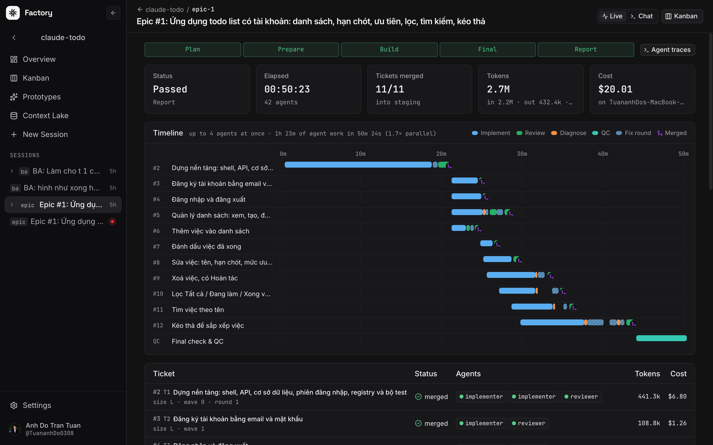
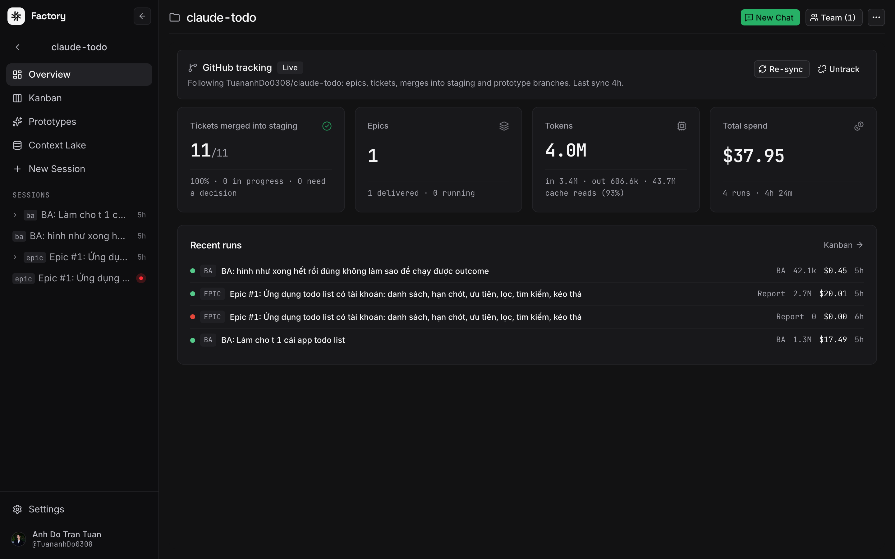
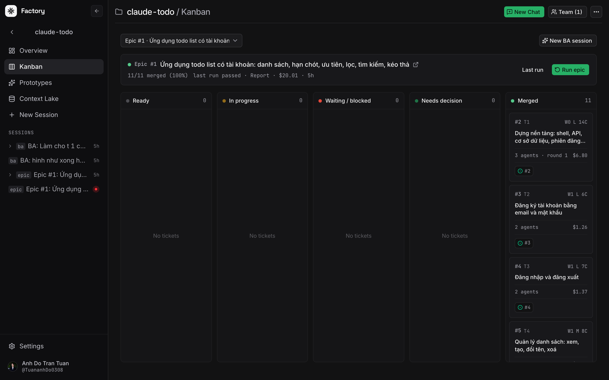
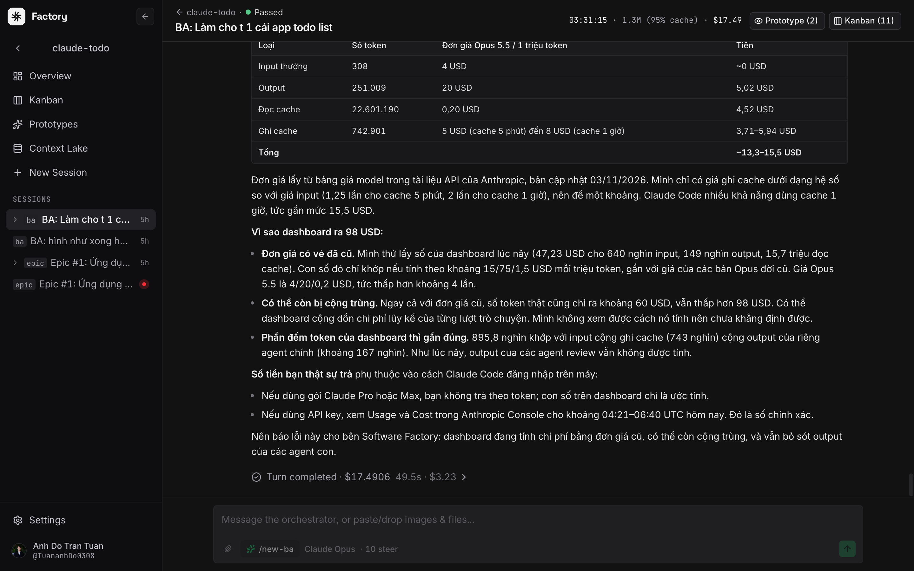
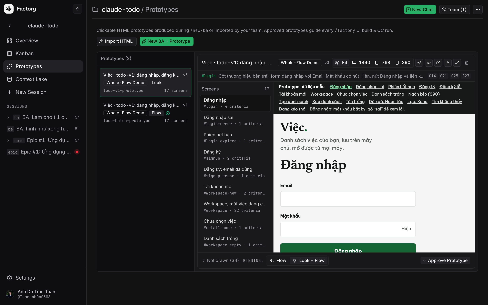
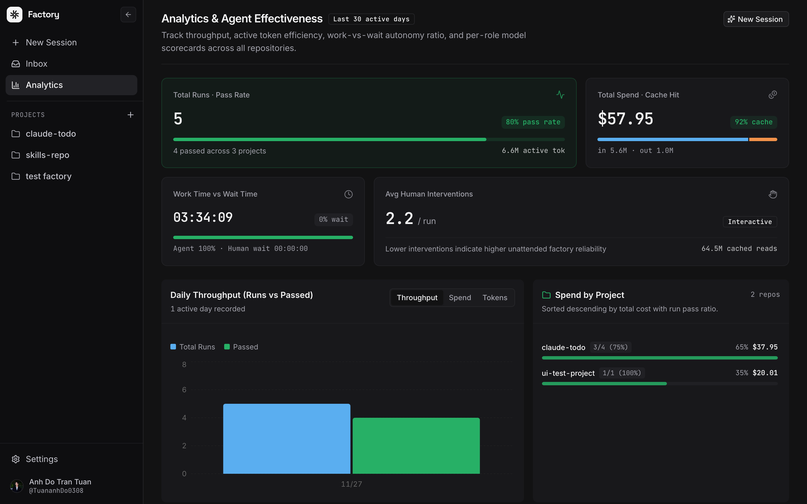
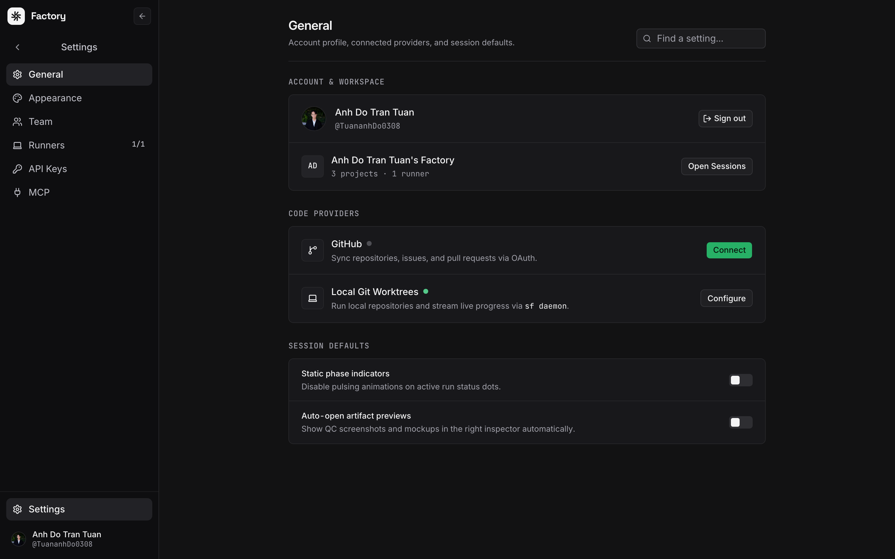
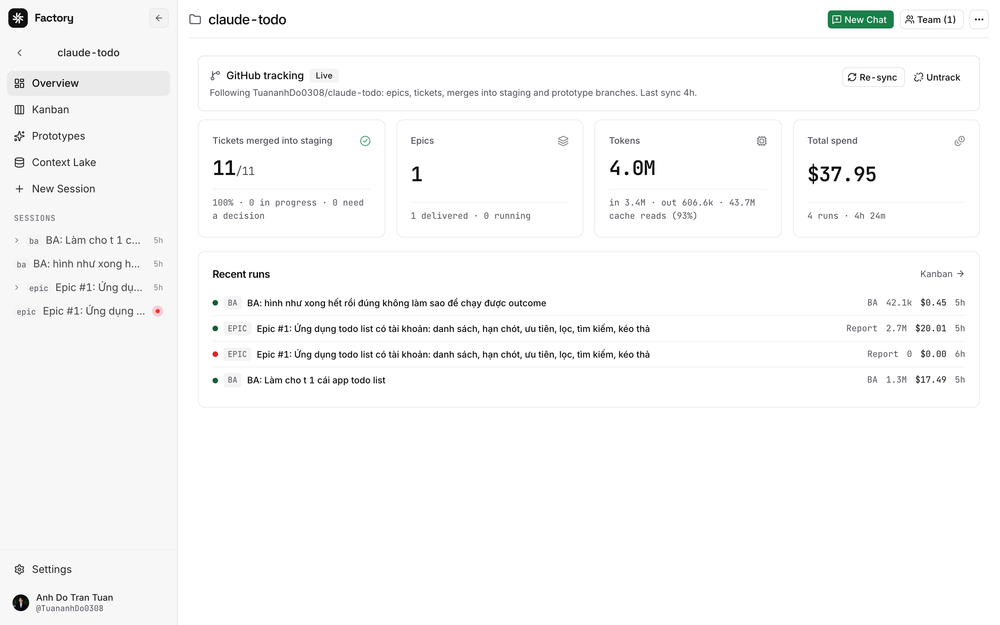
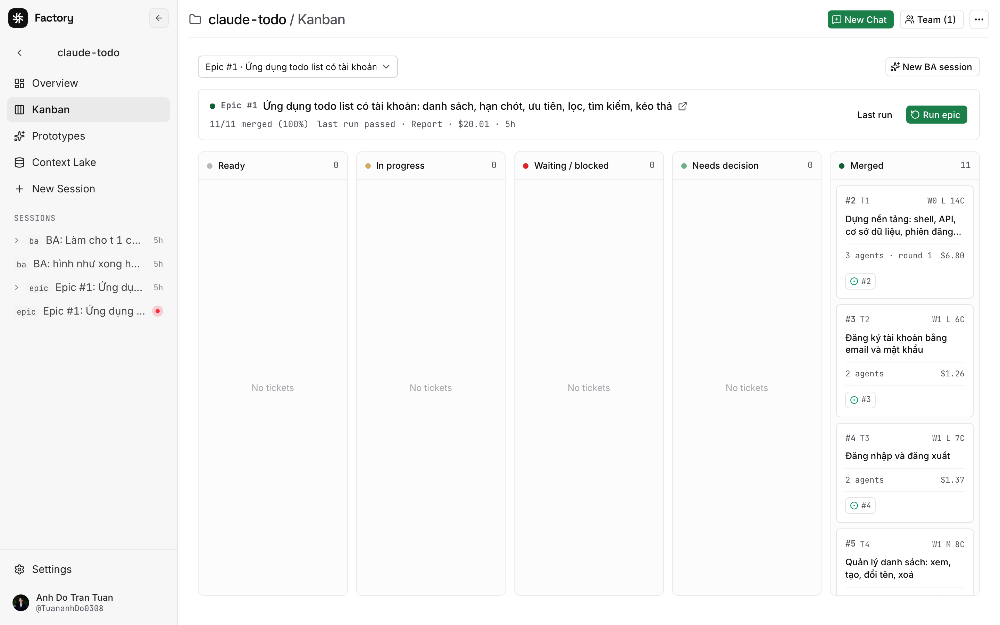

# Factory

A control plane for running an AI software team on **Claude Code**. You describe a feature in a chat; a BA agent turns it into a GitHub epic of ready tickets; one click builds the whole epic in parallel, test-first, into a `staging` branch — and the web app shows every agent, ticket, token and dollar while it happens.



<sub>A real run: the `claude-todo` epic — 11 tickets built by 42 agents in 50 minutes (up to 4 at once), all merged into `staging`, $20.01 total.</sub>

## How it works

```text
 you ──chat──▶ /new-ba ──▶ GitHub epic + tickets ──Run epic──▶ /new-factory ──▶ staging
               (BA agent)   criteria · owned files · waves      (one worktree per ticket,
                            prototype of the whole flow          test-first, reviewed, QC'd)
                    ▲                                                     │
                    └──────── sf daemon on a runner streams everything ───┘
                              (tool calls, tokens, cost, decisions) to the web app
```

1. **BA session.** Start a session with a plain request (`/new-ba Làm cho t 1 cái app todo list`). A runner's `sf daemon` runs `claude -p "/new-ba …"` in the project's clone and streams every message, tool call, token and cost to the session page. Questions come back as clickable options; the BA draws a clickable prototype of the whole flow, and when you approve, it publishes an epic and its tickets to GitHub.
2. **Epic run.** **Run epic** makes the daemon run the `new-factory` orchestrator on that epic. Each ticket gets its own worktree: an implementer writes a failing test per acceptance criterion, then the code; checks run by code, a reviewer by size, and the ticket merges into `staging` as soon as it passes — then gets QC'd in a browser. Tickets are scheduled by their dependency graph, about four at a time.
3. **Decisions.** A ticket that needs a decision shows up in **Inbox**; your answer goes back to the run and the ticket is retried.

Token and cost numbers are Claude's own (each message's usage counted once, and each process's `total_cost_usd`) — nothing is estimated.

## Screenshots

All from the `claude-todo` project: a todo app with accounts, lists, due dates, priorities, filters, search and drag-to-reorder, built end to end by the factory.

| | |
|---|---|
|  **Project overview** — GitHub tracking, tickets merged, tokens and spend per project. |  **Kanban** — every ticket of the epic, with its wave, size, agents and cost. |
|  **BA session** — the live chat with the BA agent, with duration, tokens and cost of every turn. |  **Prototypes** — the BA's clickable prototype, screen by screen, at 1440 / 768 / 390. |
|  **Analytics** — runs, pass rate, spend, cache hits and work vs wait time across projects. |  **Settings** — account, code providers, team, runners, API keys and MCP. |

Light theme:

| | |
|---|---|
|  |  |

## Repository layout

```text
factory/
├── app/        Web app (Next.js 16 + Prisma/PostgreSQL) and the `sf` CLI/daemon (cli/sf.ts)
├── skills/     The two Claude Code skills the app runs
│   ├── new-ba/       BA: request → GitHub epic + tickets (criteria, owned files, waves, prototype)
│   └── new-factory/  Builds an epic into staging (Node orchestrator, worktrees, tests, review, QC)
└── docs/       Design of the pipeline
```

## Quick start

Requirements: Node 22+, pnpm, PostgreSQL, and a [GitHub OAuth app](https://github.com/settings/developers) with callback `http://localhost:8787/auth/github/callback`.

```sh
cd app
cp .env.example .env      # DATABASE_URL, GITHUB_CLIENT_ID / GITHUB_CLIENT_SECRET, SESSION_SECRET
pnpm install
pnpm db:push              # create the tables
pnpm dev                  # http://localhost:8787
```

No PostgreSQL yet? One container is enough:

```sh
docker run -d --name software-factory-postgres -p 5433:5432 \
  -e POSTGRES_USER=sf -e POSTGRES_PASSWORD=sf -e POSTGRES_DB=software_factory postgres:16
# DATABASE_URL="postgresql://sf:sf@localhost:5433/software_factory?schema=public"
```

### Add a runner

A runner is any machine with `claude`, `gh` (signed in), `git` and Node 22+ — it does the actual work.

```sh
curl -fsSL http://localhost:8787/install.sh | bash
```

This installs `sf`, links `new-ba` and `new-factory` into `~/.claude/skills` (from `SF_SKILLS_REPO_URL`, this repository by default) and signs the runner in with a device code. Then:

```sh
sf doctor     # checks claude, gh, git, Node
sf daemon     # runs the BA sessions and epic runs the web app sends
```

See [app/README.md](app/README.md) for configuration and development.

## Tests

```sh
cd skills/new-ba && node --test tests/*.test.mjs
cd skills/new-factory && node --test tests/unit/*.test.mjs tests/integration/*.test.mjs
cd app && node --test tests/*.test.mjs        # includes the sf daemon end to end with fake claude/gh
cd app && pnpm db:generate && pnpm lint && pnpm build
```

## License

[MIT](LICENSE)
