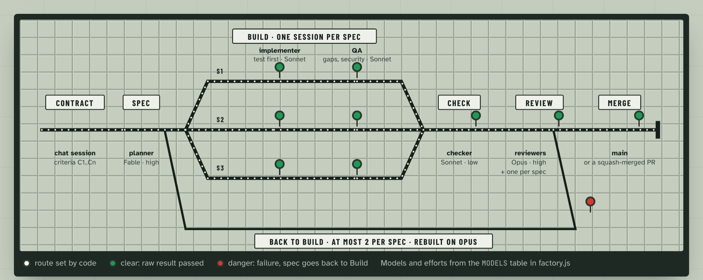
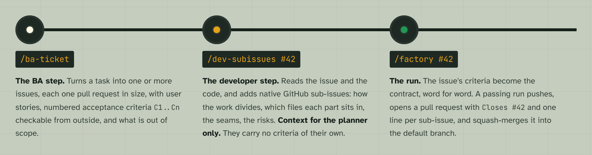
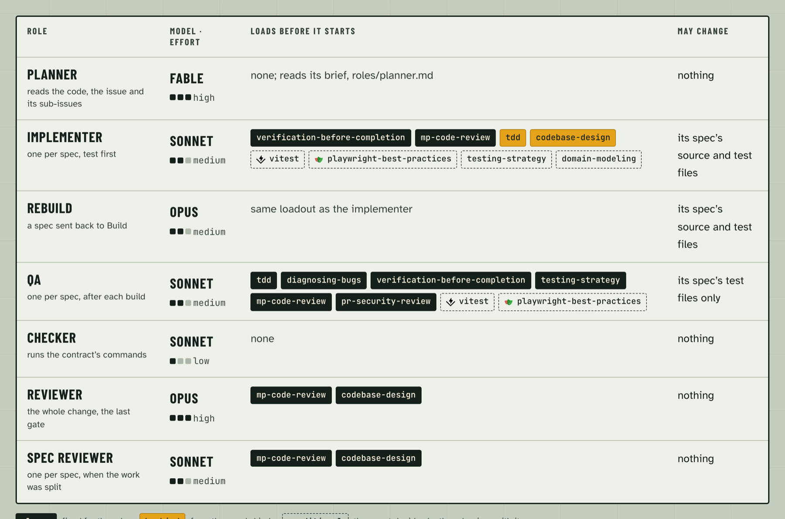

<div align="center">

# Factory

**A Claude Code skill that runs a coding task through a small team of agents: planned, built test-first, QA'd and independently reviewed.**

Orchestrated by code, not by an agent following instructions.

[Install](#install) · [Usage](#usage) · [How it works](#how-it-works) · [The team](#the-team) · [Limitations](#limitations)

</div>

<p align="center">
  
</p>

## Why Factory

One agent asked to do everything at once tends to guess and invent details. Factory splits the work so that every agent has one narrow job and a fresh context:

- **One spec, one agent, one session.** An implementer sees only its own spec. No agent is ever handed several specs.
- **Test-first, then checked by someone else.** The implementer writes each test before its code and watches it fail. A separate QA agent then reads those tests against the spec, without seeing the implementer's plan or account.
- **Reviewers judge the code, not the story.** No reviewer sees an implementer's or QA agent's narrative.
- **Code decides, not agents.** A Workflow script sets the order, decides what each agent sees, validates the plan, caps rebuilds and computes pass or fail from raw results. No agent can declare its own work done.

## Install

**Requirements:** Claude Code with the **Workflow** tool, and a git repository with at least one commit. Issue runs also need [`gh`](https://cli.github.com/), logged in.

### Option 1: paste a prompt into Claude Code

Open Claude Code in any directory and paste this. Claude downloads Factory, installs the skills the team uses and verifies the setup.

```text
Install the Factory skill for Claude Code from https://github.com/sangtruong-rgb/factory, following these steps exactly:

1. Clone the repository (git clone --depth 1) into a temporary directory.
2. If ~/.claude/skills/factory, ~/.claude/skills/ba-ticket or ~/.claude/skills/dev-subissues already exists, stop, tell me what it is (directory or symlink, and where it points) and ask me before replacing it. Never overwrite without my consent.
3. Copy the factory/, ba-ticket/ and dev-subissues/ folders of the repository to ~/.claude/skills/factory, ~/.claude/skills/ba-ticket and ~/.claude/skills/dev-subissues (step 2 applies to all three).
4. Run: bash ~/.claude/skills/factory/scripts/install-skills.sh
   It installs the skills the agent team loads (mattpocock/skills, obra/superpowers, super-board, antfu/skills, anthropics/knowledge-work-plugins, currents-dev) at pinned commits into ~/.claude/skills, and leaves any skill that is already there untouched.
5. Run: bash ~/.claude/skills/factory/scripts/skills-ready.sh "$HOME"
   It must exit 0. If it exits 10, it prints the names of the missing skills: tell me.
6. Delete the temporary directory.
7. Report: which skills were installed (including factory, ba-ticket and dev-subissues), which were kept because they already existed, whether skills-ready passed, and remind me to open a new Claude Code session to use /factory.
```

### Option 2: install by hand

```sh
git clone --depth 1 https://github.com/sangtruong-rgb/factory.git /tmp/factory-src
cp -r /tmp/factory-src/factory       ~/.claude/skills/factory
cp -r /tmp/factory-src/ba-ticket     ~/.claude/skills/ba-ticket
cp -r /tmp/factory-src/dev-subissues ~/.claude/skills/dev-subissues
bash ~/.claude/skills/factory/scripts/install-skills.sh        # team skills, pinned commits, never overwrites
bash ~/.claude/skills/factory/scripts/skills-ready.sh "$HOME"  # must exit 0
rm -rf /tmp/factory-src
```

> [!WARNING]
> If `~/.claude/skills/factory` already exists (for example an older Factory), `cp -r` mixes the new files into it. Back it up or remove it first.

Then **open a new Claude Code session** so the skills load. No custom agents need installing: each agent reads its own role brief from `factory/roles/`.

## Usage

**From a plain request**, in the repository you want to change:

```text
/factory add a --json flag to the wordstats command, keep the default output, with tests
```

The skill also triggers when you ask for a "factory" or for a team of agents to plan, build and review a task.

**From GitHub issues**, where one issue is one run and one pull request:

```text
/ba-ticket users need to export the order list to CSV, filtered by date
/dev-subissues #42
/factory #42
```

<p align="center">
  
</p>

| Skill | Role | What it does |
|---|---|---|
| `ba-ticket` | Business analyst | Clarifies the request with you and writes one or more issues, each one pull request in size, with user stories, acceptance criteria `C1..Cn` checkable from outside, and what is out of scope. Creates nothing until you approve. |
| `dev-subissues` | Developer | Reads the issue and the code and adds native GitHub sub-issues: how the work divides, which files each part touches, the seams, the risks. **Context for the planner only**: they carry no criteria of their own. |
| `factory` | The team | Takes the issue's criteria word for word as the contract. A passing run pushes, opens a pull request that closes the issue and its sub-issues, and squash-merges it into the default branch. |

> [!NOTE]
> Only the issue's criteria are graded. A requirement that lives only in a sub-issue is not checked, so `dev-subissues` proposes it as a new criterion on the issue instead.

## How it works

1. **Contract** *(your chat session)*: the goal, numbered acceptance criteria `C1..Cn`, what is out of scope, and the project's real check commands. The run gets its own branch, `factory/<id>`. `skills-ready.sh` confirms every skill the team loads is installed; a missing one stops the run before it starts.
2. **Spec** *(planner)*: reads the code and returns one or more specs. Each spec owns its files, names the criteria it answers for and has a `kind` (`feature`, `bug`, `ux`, `refactor`, `tech-debt`, `tests`, `docs`). Code rejects the plan with reasons if a criterion is uncovered, a file has two owners, a file is both source and test, a skill is not installed, or the dependencies form a cycle.
3. **Build** *(implementer, then QA, per spec)*: the implementer writes each test, sees it fail for the right reason, then writes the code. A fresh QA agent maps criteria to tests, hunts edge cases and tests that cannot fail, runs a code review and a security pass, and adds tests for serious gaps. Independent specs build in parallel; dependent specs wait for the level before them.
4. **Check** *(checker)*: runs the contract's commands and lists the changed files. A changed file that no spec owns stops the run.
5. **Review** *(reviewers)*: a fresh reviewer judges the whole change against the contract. When the work was split, each spec also gets its own reviewer. A criterion is met only if every reviewer responsible for it says so.
6. **Back to Build**: there is no separate repair phase. Each failure is routed to the spec whose files it concerns; that spec gets a new implementer session (on Opus) and QA again, then the whole change is checked and reviewed again. A spec may go back at most `maxRebuilds` times (default 2) before the run fails.
7. **Verify and merge** *(your chat session)*: reruns the checks itself. Only if the workflow returns `passed` and the rerun passes does it commit the specs' files and fast-forward the branch it started from. A failed run stays on `factory/<id>` and your branch is untouched.

<p align="center">
  
</p>

**Pass or fail is computed by code:** every check exits `0`, every criterion is judged met, and no blocking finding remains. When a decision needs a human (a wrong spec, an implementer needing a file outside its ownership), the workflow stops with `blocked` and hands back to you.

For issue runs, the session pushes the branch, opens a pull request with `Closes #<issue>` and one `Closes #<sub-issue>` line per sub-issue, and runs `gh pr merge --squash`. If GitHub refuses (branch protection, pending checks, conflicts), the pull request stays open and the session tells you why. It never uses `--admin`.

## The team

<p align="center">
  
</p>

Models are chosen per role in code (the `MODELS` table in `factory.js`). The strongest models go where a mistake costs the most: a wrong spec misleads every agent after it, and the whole-change reviewer is the last gate. Override any role with the `models` arg, for example `{"implementer": {"model": "opus"}}`.

<details>
<summary><b>Skills each agent loads</b></summary>

<br>

Skills are third-party, installed at pinned commits and never bundled. The `SKILLS` registry in `factory.js` picks them per role, following super-board's registry row for row.

| Agent | Always | By spec `kind` | Conditional (agent decides by rule) |
|---|---|---|---|
| Implementer | `verification-before-completion`, `mp-code-review` | `bug`: `diagnosing-bugs`, `tdd` · `feature`: `tdd`, `codebase-design` · `ux`: `tdd` · `refactor`, `tech-debt`: `codebase-design`, `tdd` · `tests`: `tdd` · `docs`: none | `vitest`, `playwright-best-practices`, `testing-strategy`, `domain-modeling` |
| QA | `tdd`, `diagnosing-bugs`, `verification-before-completion`, `testing-strategy`, `mp-code-review`, `pr-security-review` | | `vitest`, `playwright-best-practices` |
| Reviewers | `mp-code-review`, `codebase-design` | | |

**Sources:** [mattpocock/skills](https://github.com/mattpocock/skills), [obra/superpowers](https://github.com/obra/superpowers), [EricTechPro/super-board](https://github.com/EricTechPro/super-board), [antfu/skills](https://github.com/antfu/skills), [anthropics/knowledge-work-plugins](https://github.com/anthropics/knowledge-work-plugins), [currents-dev](https://github.com/currents-dev). mattpocock's `code-review` is installed as `mp-code-review` so it does not shadow Claude Code's built-in `/code-review`. A spec may name its own `skills` to replace the `kind` set.

Differences from super-board: mattpocock's `implement` and `ask-matt` are blocked for agents; `resolving-merge-conflicts` is no longer published and runs never merge mid-way; the `ponytail` plugin has no public source, so its "simplest solution first" rule is written into the implementer brief and reviewers flag over-engineering as `minor`.

</details>

## Dashboard

The skill ships with a static dashboard. Open `factory/dashboard/index.html` in a browser to see the team, the run in progress (refreshed every few seconds), past runs and the benchmark.

<p align="center">
  
</p>

After each run the session can also report it to XS Factory Bench with `xfb report`, if `xfb` is installed. This never changes the run.

## Repository layout

```text
ba-ticket/                 BA skill: task → issues with criteria C1..Cn
dev-subissues/             Dev skill: issue → sub-issues as planner context
factory/
├── SKILL.md               instructions for the chat session: contract, run, verify, merge, report
├── workflow/factory.js    the Workflow script that orchestrates the team
├── roles/                 one brief per role (planner, implementer, qa, checker, reviewer, spec-reviewer)
├── scripts/               install-skills.sh, skills-ready.sh, FactoryBench reporting
├── dashboard/             index.html, runs.js (finished runs), live.js (run in progress, not committed)
└── evals/                 skill test cases
tests/                     node --test tests for the pure helpers in factory.js
docs/images/               screenshots for this README
```

## Limitations

Factory is a deliberately small baseline. These rules are still enforced by prompts rather than by code:

- **Read-only roles are asked, not forced.** The planner, checker and reviewers are told not to edit; code only catches files changed outside every spec's ownership.
- **Test-first is self-reported.** The implementer reports its red-green steps; code cannot verify it saw each test fail.
- **Shared misreadings can pass.** Tests come from the agent that wrote the code. QA and reviewers read them against the spec, but a misunderstanding they all share can still get through.
- **Rebuilt tests may change.** On a rebuild the implementer may edit its own tests. Every test file changed after the first build is recorded and reported to you.
- **Unattributed failures cost more.** A failing check whose output names no spec file goes back to every spec.
- **No resume.** A run's state is not saved; when the session ends, the run ends with it.
- **Issue runs merge without a human on GitHub.** QA, the reviewers and the session's own rerun of the checks are the only gate. Failed runs are never pushed.
- **Third-party skills assume a person at the keyboard.** Agents are told nobody will answer, that the spec's interfaces are the agreed seams, and that the brief wins over a skill. Whether they comply is up to the prompt.

## Development

```sh
node --test          # tests for the pure helpers in factory/workflow/factory.js
```

See [CLAUDE.md](CLAUDE.md) for how the script, the role briefs and the tests fit together.
