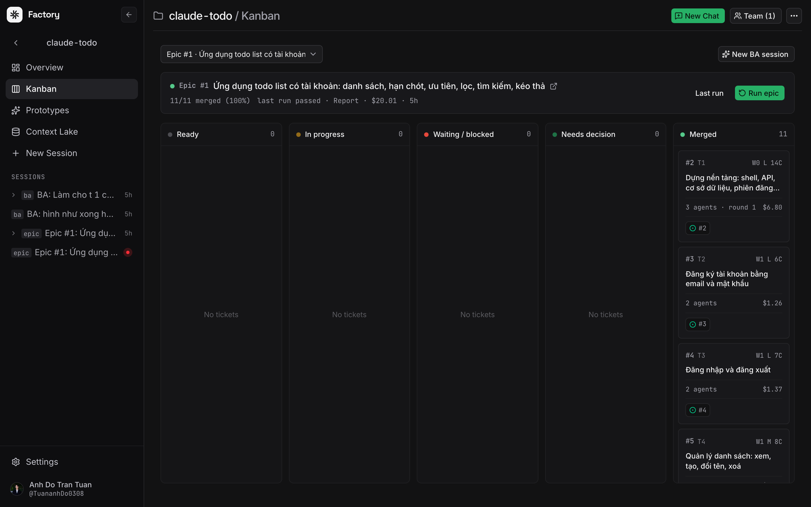

# Software Factory

Web control plane and `sf` runner daemon for running **factory v2** (`new-ba` and `new-factory`) on **Claude Code**. For what it does and screenshots, see the [repository README](../README.md).



## Stack

- **Framework**: Next.js 16 (App Router, React 19, TypeScript)
- **UI**: shadcn/ui (`base-nova` / `@base-ui/react`), `lucide-react`, Tailwind CSS v4, Inter + JetBrains Mono
- **Database**: PostgreSQL via Prisma 7 + `@prisma/adapter-pg`
- **Real-time**: Server-Sent Events (`/api/stream`) fed by the `sf daemon` runner bridge
- **Auth**: GitHub OAuth for people; device-code flow and API tokens for runners

## Setup

```bash
cp .env.example .env
pnpm install                  # also runs prisma generate
pnpm db:push                  # create / update the tables
pnpm dev                      # http://localhost:8787
```

After changing `prisma/schema.prisma`, run `pnpm db:generate && pnpm db:push` and restart `pnpm dev` — a running dev server keeps the old Prisma client in memory.

### Environment

| Variable | Required | What it is |
|---|---|---|
| `DATABASE_URL` | yes | PostgreSQL connection string. `DATABASE_URL_UNPOOLED` (optional) is used by the Prisma CLI. Vercel's `POSTGRES_*` names work too. |
| `APP_PUBLIC_URL`, `NEXT_PUBLIC_APP_URL` | yes | The URL people and runners use, e.g. `http://localhost:8787`. |
| `GITHUB_CLIENT_ID`, `GITHUB_CLIENT_SECRET` | yes | GitHub OAuth app; callback `<APP_PUBLIC_URL>/auth/github/callback`. |
| `SESSION_SECRET` | yes | 32-byte random hex: `openssl rand -hex 32`. |
| `FACTORY_WORKSPACES_DIR` | yes | Where the app keeps project workspaces. |
| `FACTORY_BOT_GITHUB_USERNAME` | yes | GitHub account the runners act as; projects invite it as a collaborator. |
| `FACTORY_BOT_GITHUB_TOKEN` | no | PAT for that account, to auto-accept collaborator invites. |
| `SF_SKILLS_REPO_URL` | no | Repository runners install `new-ba` / `new-factory` from (this one by default). |
| `GITHUB_API_URL` | no | GitHub Enterprise API base. |
| `SF_ALLOWED_DEV_ORIGINS` | no | Extra hosts allowed to load `next dev` assets when sharing on a LAN. |

Never commit `.env`; it is git-ignored.

## CLI & runner daemon (`sf`)

`cli/sf.ts` is one self-contained file (it is served to runners at `/api/cli/sf.ts`, so keep it one file). A runner needs Node 22+, `claude`, `gh` (signed in) and `git`.

```bash
curl -fsSL http://localhost:8787/install.sh | bash   # install sf + skills, sign in

# or straight from this repository
node cli/sf.ts doctor                                # check prerequisites
node cli/sf.ts login --url http://localhost:8787     # device code or API token
node cli/sf.ts daemon                                # run BA sessions and epic runs from the web app
```

The daemon ↔ web API is specified in [docs/factory-v2-contract.md](docs/factory-v2-contract.md); change both sides and the contract together.

## Tests

```bash
node --test tests/*.test.mjs          # includes sf daemon end to end with fake claude/gh
pnpm db:generate && pnpm lint && pnpm build
```
