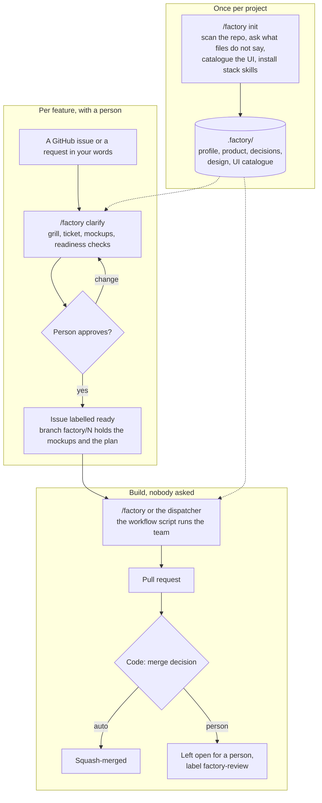
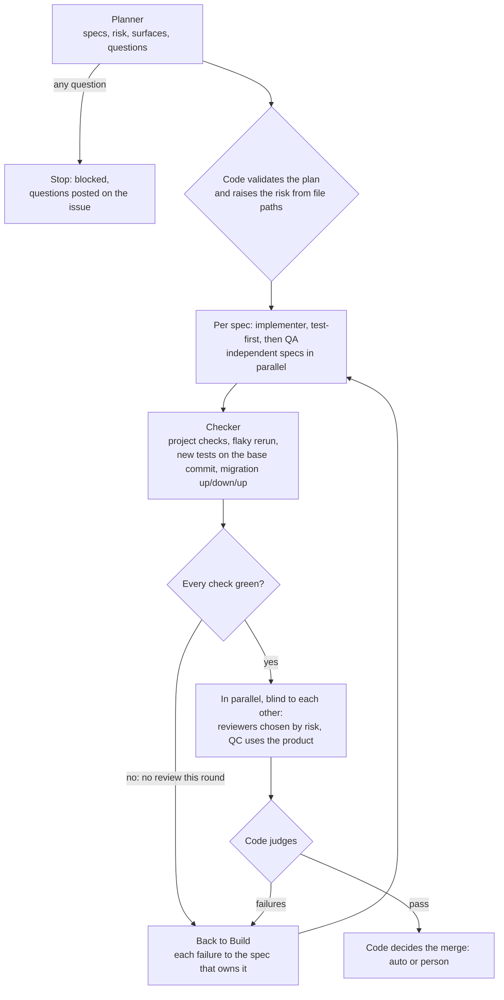
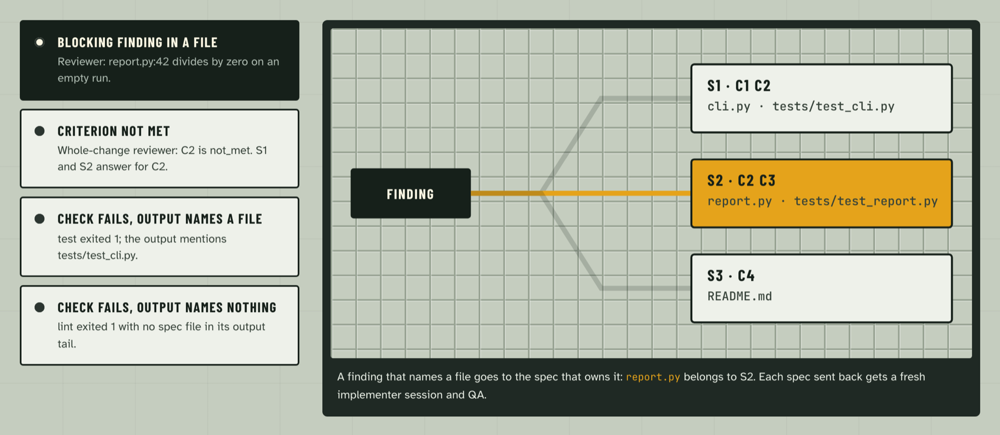
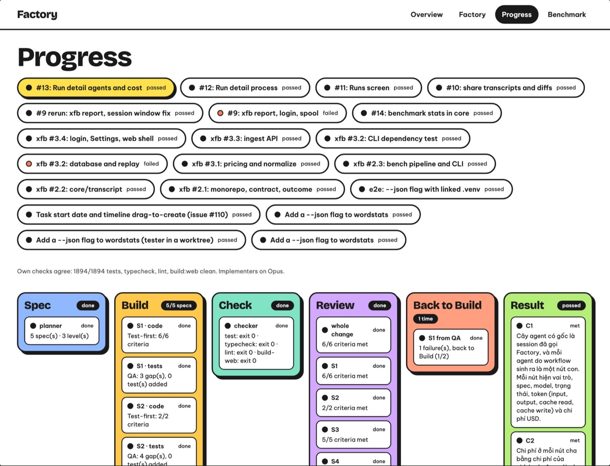

<div align="center">

# Factory

**Claude Code skills that take a project from setup to merged pull requests: set the project up once, clarify each feature with a person, then let a team of agents build it test-first, check it, review it by risk and use it before it passes.**

Orchestrated by code, not by an agent following instructions.

[Pipeline](#the-pipeline) · [Install](#install) · [Usage](#usage) · [The build loop](#the-build-loop) · [What each agent gets](#what-each-agent-gets) · [Testing coverage](#testing-coverage) · [Limitations](#limitations)

</div>

## Why Factory

One agent asked to do everything at once tends to guess and invent details. Factory moves every question to the one step where a person can answer it, and splits the build so that every agent has one narrow job and a fresh context:

- **Questions are asked before the build, never during it.** `/factory clarify` grills the person, writes the ticket, draws the new screens and gets an approval. From then on nobody is asked anything: a run that still finds a question stops and posts it on the issue.
- **One spec, one agent, one session.** An implementer sees only its own spec. No agent is ever handed several specs.
- **Test-first, and proven.** The implementer writes each test before its code. When the project gives a command to run single test files, code runs the new tests on the base commit: a test that already passes there proves nothing and sends the spec back.
- **Review scaled to risk.** The planner rates the risk; code raises it from the files touched (auth, money, migrations, dependencies, CI) and picks the reviewers and their models from it.
- **Someone uses the product.** A QC agent that has seen neither the specs nor the diff starts the product, tries each criterion (in a browser it clicks and types by hand through Playwright MCP, writing no script), compares new screens with their approved mockups and the screens that must not break with how they looked before.
- **Code decides, not agents.** A Workflow script sets the order, decides what each agent sees, validates the plan, caps rebuilds, computes pass or fail from raw results and decides whether a passing change may merge without a person.

## The pipeline



| Step | Who works | Who decides |
|---|---|---|
| `/factory init` | scripts scan the stack, design, routes and UI; the session asks the person the rest | the person confirms the profile; `project-check.mjs` checks it |
| `/factory clarify` | the session grills, writes the ticket and draws mockups; the planner runs alone to find open questions | `ready-check.mjs`, the planner's questions, then the person's approval |
| Build | planner, implementers, QA, checker, reviewers, QC | the workflow script: pass, back to Build, blocked or failed |
| Merge | the session pushes and opens the pull request | code's `merge.decision`: `auto`, or `person` with the reasons |
| Report | the session files the run record; `pr-judge` grades the pull request from outside | nothing: reporting never changes a run |

## Install

**Requirements:** Claude Code with the **Workflow** tool, and a git repository with at least one commit. Issue runs also need [`gh`](https://cli.github.com/), logged in. A project with a UI needs Playwright MCP in `.mcp.json` (factory-init adds it) or `~/.claude.json` (`claude mcp add`), and a session started after it was configured, so QC can click through the screens. `ui-refine-loop` also needs `node`, `gh`, and Playwright resolvable from the project it polishes. `pr-judge` needs `node` and `gh`, logged in.

### Option 1: paste a prompt into Claude Code

Open Claude Code in any directory and paste this. Claude downloads Factory, installs the skills the team uses and verifies the setup.

```text
Install the Factory skill for Claude Code from https://github.com/sangtruong-rgb/factory, following these steps exactly:

1. Clone the repository (git clone --depth 1) into a temporary directory.
2. If ~/.claude/skills/factory, ~/.claude/skills/factory-init, ~/.claude/skills/factory-clarify, ~/.claude/skills/ba-ticket, ~/.claude/skills/dev-subissues, ~/.claude/skills/ui-refine-loop or ~/.claude/skills/pr-judge already exists, stop, tell me what it is (directory or symlink, and where it points) and ask me before replacing it. Never overwrite without my consent.
3. Copy the factory/, factory-init/, factory-clarify/, ba-ticket/, dev-subissues/, ui-refine-loop/ and pr-judge/ folders of the repository to the folders of the same names under ~/.claude/skills (step 2 applies to all seven).
4. Run: bash ~/.claude/skills/factory/scripts/install-skills.sh
   It installs the skills the agent team loads (mattpocock/skills, obra/superpowers, super-board, antfu/skills, anthropics/knowledge-work-plugins, currents-dev) at pinned commits into ~/.claude/skills, and leaves any skill that is already there untouched.
5. Run: bash ~/.claude/skills/factory/scripts/skills-ready.sh "$HOME"
   It must exit 0. If it exits 10, it prints the names of the missing skills: tell me.
6. Delete the temporary directory.
7. Report: which skills were installed (including factory, factory-init, factory-clarify, ba-ticket, dev-subissues, ui-refine-loop and pr-judge), which were kept because they already existed, whether skills-ready passed, and remind me to open a new Claude Code session and run /factory init in each project.
```

### Option 2: install by hand

```sh
git clone --depth 1 https://github.com/sangtruong-rgb/factory.git /tmp/factory-src
cp -r /tmp/factory-src/factory       ~/.claude/skills/factory
cp -r /tmp/factory-src/factory-init  ~/.claude/skills/factory-init
cp -r /tmp/factory-src/factory-clarify ~/.claude/skills/factory-clarify
cp -r /tmp/factory-src/ba-ticket     ~/.claude/skills/ba-ticket
cp -r /tmp/factory-src/dev-subissues ~/.claude/skills/dev-subissues
cp -r /tmp/factory-src/ui-refine-loop ~/.claude/skills/ui-refine-loop
cp -r /tmp/factory-src/pr-judge      ~/.claude/skills/pr-judge
bash ~/.claude/skills/factory/scripts/install-skills.sh        # team skills, pinned commits, never overwrites
bash ~/.claude/skills/factory/scripts/skills-ready.sh "$HOME"  # must exit 0
rm -rf /tmp/factory-src
```

> [!WARNING]
> If `~/.claude/skills/factory` already exists (for example an older Factory), `cp -r` mixes the new files into it. Back it up or remove it first.

Then **open a new Claude Code session** so the skills load, and run `/factory init` in each project you want to build with it. The skills live in your Claude Code (`~/.claude/skills`), not in your project; a project only gets `.factory/`, its stack skills in `.claude/skills/` and the files the runs produce. No custom agents need installing: each agent reads its own role brief from `factory/roles/`.

## Usage

**Set a project up**, once, in its repository:

```text
/factory init
```

It checks first, in one command (`init-status.mjs`), whether the project is already set up and current, and stops if it is, so running it again costs almost nothing. A stopped init resumes; a project whose files changed redoes only the steps those files feed.

**Clarify each feature**, from a request or an issue:

```text
/factory clarify users need to export the order list to CSV
/factory clarify #42
```

**Build it** once it is `ready`, by hand or through the dispatcher:

```text
/factory #42
```

`/factory` sends anything that is not a ready issue to `factory-clarify` first. A plain request still works for small changes (`/factory add a --json flag to the wordstats command, with tests`).

| Skill | When | What it does |
|---|---|---|
| `factory-init` | Once per project | Tells a new project from an existing one. A new project gets its requirements, stack (2–3 options, an ADR, a scaffold with CI) and design direction settled with you. An existing one gets its stack and commands read from its manifests and confirmed, its UI catalogued from the code (`scan-ui.mjs`: every component with its props, variants and usage, style helpers, duplicates with the preferred one, the file to copy for each pattern), optionally its screens captured, and its design written down. Finds the best vetted skills for the stack (`catalog/stack-skills.json`, pinned commits) and installs them into the project's `.claude/skills/`. Writes `.factory/`, `CODING_STANDARDS.md`, `.mcp.json` (Playwright MCP for UI projects) and `CLAUDE.md` defaults, and checks every command passes. |
| `factory-clarify` | Before every build | Takes an issue or a request, reads the profile, decisions, catalogue and code it touches, and how earlier tickets of that kind went (`issue-history`), then grills you in waves of at most three questions with a recommended answer each. Writes the ticket (criteria `C1..Cn` as Given / When / Then with real values, UI and states, data, permissions, copy, out of scope), proposes a split when it is more than one pull request, draws each new screen from the app's own components and tokens, and lists the existing screens that must not break. Checks it with `ready-check.mjs` and with the planner alone (`questionsOnly`), keeps the planner's plan in `.factory/plans/N.json`, and after you approve opens or rewrites the issue, pushes `factory/N` with the mockups and the plan, and labels it `ready`. |
| `factory` | Each ready issue | Runs the build loop below, verifies the result itself, opens the pull request and merges it only when code says `auto`. |
| `ba-ticket`, `dev-subissues` | Optional | Write an issue (`ba-ticket`) or add sub-issues as planner context (`dev-subissues`) without the mockups and checks of `factory-clarify`. Issues they create carry the label `factory` and `kind/<kind>`. |

Issues the factory creates carry the label `factory`, so they never mix with issues people write by hand. Labels on the way: `needs-info` (a question is open), `ready` (the AI's from now on), `factory-review` (a passing pull request that waits for a person). [`factory/github/`](factory/github/README.md) holds a GitHub Action that hands each `ready` issue, in dependency order, to a Claude Code session on a self-hosted runner.

> [!NOTE]
> Only the issue's criteria are graded. A requirement that lives only in a sub-issue or a comment is not checked.

### Standalone skills

**Polishing a page afterwards**, when it works but looks off:

```text
/ui-refine-loop /dashboard/reports "the summary strip feels cramped"
/ui-refine-loop src/components/ReceiptViewer.tsx "mobile layout breaks under 400px" --rounds 3
```

`ui-refine-loop` is a separate, standalone skill: you start it, and the Factory team never runs it. It reads the page's code, asks you at most 10 questions about goal and direction, then runs bounded check → fix rounds in its own worktree and branch (`refine/<slug>`). Each round a design reviewer and a detector judge the page in isolation, a checker ranks the problems, and a fixer lands one commit with the checks green, or reverts. It ends in a **draft** pull request with a Before | After table (light and dark, 1440 and 390 wide) and a grade for every fix. It never merges: whether a page looks better is your call.

It works best with the [Impeccable](https://github.com/pbakaus/impeccable) skill installed (`.claude/skills/impeccable` or `.agents/skills/impeccable`, in the project or your home directory); without it the loop warns loudly and scores with a built-in rubric. Per-project settings (dev command, checks, sign-in script, data states) go in `.claude/ui-refine-loop.json`; see [`ui-refine-loop/references/config.md`](ui-refine-loop/references/config.md). Adapted from [super-board](https://github.com/EricTechPro/super-board)'s `ui-refine-loop` (MIT, see [`ui-refine-loop/NOTICE.md`](ui-refine-loop/NOTICE.md)).

**Judging a pull request**, from a clone of its repository:

```text
/pr-judge 42
/pr-judge 42 --issue 17 --no-send
```

`pr-judge` is another standalone skill, and the one place the team's output is graded from outside the team. It loads none of the skills the team loads (`mp-code-review`, `pr-security-review`, `tdd` and the rest), so the team never grades itself. It checks the pull request and the merge base out in worktrees and runs measured checks: build, type check, lint, format and tests with the base's commands, on the head and, when the head fails, on the base; dependencies added; code changed without a test; shortcuts around the checks such as `@ts-ignore`, `.skip` or a deleted assertion; and SonarQube when it is set up. Then one isolated judge per criterion of [`pr-judge/rubric.md`](pr-judge/rubric.md) reads the change: the issue's acceptance criteria `C1..Cn`, readability, fit with the repository, simplicity, failure handling, tests, security and merge readiness. It writes `report.md` and `report.json` under `~/.factory/judge/` with a pass / fail / unknown verdict decided by code, not by a judge. It refuses a pull request from a fork unless you pass `--allow-fork`, since the checks run its code. The rubric is a draft and the judges are uncalibrated: read the verdict beside the report, not instead of it.

## The build loop



1. **Contract** *(your chat session)*: the issue's criteria word for word, what is out of scope, and the project's part from `project-check.mjs --contract`: its check commands, how to run the app, its design pointers, `testFileCommand`, the migration commands, its stack, skills per role and docs. A clarified issue also brings its mockups (`design.screens`), the screens that must not break (`design.baseline`) and the approved plan, which is reused while the criteria and the files it touches are unchanged. The run works on `factory/N`. A missing skill stops the run before it starts.
2. **Spec** *(planner)*: reads the code and returns specs. Each owns its files, names the criteria it answers for and has a `kind` (`feature`, `bug`, `ux`, `refactor`, `tech-debt`, `tests`, `docs`). It rates the risk (`low`, `medium`, `high`) and the surfaces (`ui`, `security`, `data`), and returns `questions` instead of guessing; any question stops the run. Code rejects the plan if a criterion is uncovered, a file has two owners, a skill is not installed or the dependencies form a cycle, and raises the risk from the files the specs own (below).
3. **Build** *(implementer, then QA, per spec)*: the implementer writes each test, sees it fail, then writes the code, following the project's design rules and UI catalogue (the preferred component of any duplicate, the pattern file for a form or a table). A fresh QA agent maps criteria to tests, hunts edge cases and tests that cannot fail, runs a security pass and adds tests for serious gaps. Independent specs build in parallel.
4. **Check** *(checker)*: runs the contract's commands and lists the changed files.
   - A failing command is run again once; a check that then passes is reported as flaky, not sent back.
   - With `testFileCommand`, the new tests of each `feature`, `bug` and `ux` spec are run in a worktree of the base commit. Tests that pass there send the spec back: they do not show the change.
   - With migration commands, the migration is run up, down and up again.
   - When a test command fails but its failing files pass alone, it bisects for the file that leaks state into them.
   - A changed file that no spec owns, or a change to a protected path (CI, check configuration, `.factory/`), stops the run.
5. **Gate**: while any check is red, no reviewer and no QC runs that round. The failures go straight back to Build.
6. **Review and QC** *(in parallel)*: reviewers read the code; QC uses the product. Neither sees the other's verdict.

   | Risk | Whole-change reviewer | One reviewer per spec (2+ specs) |
   |---|---|---|
   | `low` | Sonnet, medium effort | none |
   | `medium` | Opus, high effort | Sonnet, medium effort |
   | `high` | Opus, xhigh effort | Opus, high effort |

   Code raises the planner's rating, never lowers it: files about auth, sessions, permissions, payments or billing make the run `high` with surface `security`; a migration makes it `high` with surface `data`; dependency manifests, lockfiles or CI files make it at least `medium`; UI files add surface `ui`. Surface `security` adds `pr-security-review` to the reviewers.

   QC runs every round whatever the risk (turn it off with `qc: false` for a change nobody can see). It tries each criterion through the product's real entry point (a screen by hand, one click at a time with Playwright MCP's browser tools, never a script it writes first; a run with a screen stops at the start without them), compares each new screen with its approved mockup, compares each must-not-break screen with its screenshot from before the build (a change the ticket does not ask for is a `regression`, sent back to the specs that own UI files), and scans each screen with axe: a serious or critical violation fails the screen's criteria. QC changing a file stops the run.
7. **Back to Build**: each failure goes to the spec whose files it concerns, which gets a new implementer session (on Opus) and QA again. A spec may go back `maxRebuilds` times (default 2) before the run fails.
8. **Merge decision** *(code)*: a passing run gets `merge: { decision, reasons }`. It is `person` when the change touches auth, money, a migration, a dependency or CI, was rated `high`, changes a visible screen, or rewrote tests after the first build (the list is the profile's `escalate`). Otherwise `auto`.
9. **Verify and merge** *(your chat session)*: reruns the checks itself (and CI's test jobs in a Linux container when Docker is there), pushes, and opens a pull request that closes the issue. It squash-merges only when the decision is `auto` and CI is green; otherwise it leaves the pull request open with the reasons in a comment and the label `factory-review`. It never uses `--admin`.
10. **Report and lessons** *(your chat session)*: the run record (outcome, failure log, risk and why it was raised, merge decision, questions, flaky checks, specs whose tests could not be proven) goes to the dashboard. A mistake the team made in 3 of the last 10 runs becomes a proposed rule for you to accept or reject.

<p align="center">
  
</p>

**Coding standards are written down and checked rule by rule.** factory-init writes `CODING_STANDARDS.md` from a template the tech lead edits: a table of rules `S1..Sn`, each `blocking` or `minor`, each kept either by a check (`check: lint`, `format`, `typecheck`, `test`; code decides it from the exit code, and a rule naming a check the project lacks stops the run) or by review (every reviewer judges it on the code it reads, with the file and line of each break). Implementers are shown every rule. A broken blocking rule goes back to the spec owning the file; a minor one is reported. Each run reports every rule as pass, fail, not applicable or not judged.

**Pass or fail is computed by code:** every check exits `0` (or passed on its rerun), every new test was shown to fail on the base code, every criterion is judged met by its reviewers and seen working by QC, no must-not-break screen regressed, no blocking coding standard is broken, and no blocking finding remains. When a decision needs a person, the workflow stops with `blocked` and says why.

## What each agent gets

Init writes the project down once; every run hands the right part of it to each agent, so no agent has to rediscover the stack or the design.

| Agent | Model (default) | Project context | Skills |
|---|---|---|---|
| Planner | Fable, high | `CLAUDE.md`, decisions, stack, product, glossary, the issue and its sub-issues, the approved plan | `codebase-design` (deep modules, clean seams), `domain-modeling` when the domain needs it, the profile's planner skills, the repo's own `.claude/skills` |
| Implementer | Sonnet, medium (Opus on a rebuild) | `CLAUDE.md`, decisions, stack, design rules, UI catalogue, its spec's mockups | by spec `kind` (`tdd`, `diagnosing-bugs`, `codebase-design`), `verification-before-completion`, `mp-code-review`, the stack skills init installed (for example `vitest`), the repo's own skills |
| QA | Sonnet, medium | `CLAUDE.md`, decisions, stack, its spec without the implementer's plan | `tdd`, `testing-strategy`, `diagnosing-bugs`, `mp-code-review`, `pr-security-review`, `verification-before-completion`, the stack's test skills |
| Checker | Sonnet, low | the commands only | none |
| Reviewers | by risk (above) | `CLAUDE.md`, decisions, stack, product, glossary, design rules with the blocking ones (for example a non-preferred component) | `mp-code-review`, `codebase-design`, `pr-security-review` on surface `security`, the profile's reviewer skills, the repo's own skills |
| QC | Sonnet, medium | the criteria, how to run the app, the mockups and the before screenshots. Not the diff, not the specs | none of the review skills, on purpose, and no skill for writing browser tests: it clicks through Playwright MCP by hand; the profile's QC skills |

Pick a preset with `modelProfile` (`balanced` default, `fast`, `flagship`, or `inherit`, defined in `factory/catalog/model-profiles.json`), or override any model with the `models` arg, for example `{"implementer": {"model": "opus"}}`. Third-party skills are installed at pinned commits, never bundled: [mattpocock/skills](https://github.com/mattpocock/skills), [obra/superpowers](https://github.com/obra/superpowers), [EricTechPro/super-board](https://github.com/EricTechPro/super-board), [antfu/skills](https://github.com/antfu/skills), [anthropics/knowledge-work-plugins](https://github.com/anthropics/knowledge-work-plugins), [currents-dev](https://github.com/currents-dev). mattpocock's `code-review` is installed as `mp-code-review` so it does not shadow Claude Code's built-in `/code-review`.

## Testing coverage

The roles are not tests themselves; each writes tests, runs them, or uses the product.

| Role | What it does with tests | Integration | Regression |
|---|---|---|---|
| Implementer | writes the tests first, at the cheapest layer that shows the criterion: unit, then integration, then the real entry point | when it picks that layer | its tests guard every later change |
| QA | adds tests for serious gaps, flags tests that only assert on their own mocks | when it picks that layer | same |
| Checker | runs the whole suite and every check command each round, new tests on the base commit, migrations both ways | runs the ones the suite has | **yes, for code** |
| Reviewers | read the code; run nothing | no | no |
| QC | uses the product for this issue's criteria and the screens listed as must-not-break | end to end, by hand; leaves no test behind | **yes, for the listed screens** |

## Dashboard

Open `factory/dashboard/index.html` to see the team, the run in progress, past runs with their failure logs and the lessons proposed from recurring failures.

<p align="center">
  
</p>

## Repository layout

```text
factory-init/              setup, once: scan → ask → .factory/ profile, design, UI catalogue, stack skills
factory-clarify/           before each build: issue or prompt → grill → ticket + mockups → approve → ready
ba-ticket/                 optional: task → issues with criteria C1..Cn (checklists by kind, templates)
dev-subissues/             optional: issue → sub-issues as planner context
ui-refine-loop/            standalone: check → fix loop that polishes one page, ends in a draft PR
pr-judge/                  standalone: grades one pull request from outside the team
factory/
├── SKILL.md               the chat session's part: contract, run, verify, merge, report
├── workflow/factory.js    the Workflow script that runs the team
├── roles/                 one brief per role (planner, implementer, qa, checker, reviewer, spec-reviewer, qc)
├── scripts/               setup: init-status, detect-stack, detect-design, scan-ui, find-routes, capture-screens,
│                          find-skills, stack-skills, init-skeleton, project-check
│                          issues: factory-issue.sh, ready-check, next-issue, issue-history
│                          team: install-skills.sh, skills-ready.sh
├── catalog/               stack-skills.json (vetted stack skills, pinned commits), model-profiles.json (named model presets)
├── github/                factory-dispatch.yml, the GitHub Action for a self-hosted runner, and its setup
├── dashboard/             index.html, runs.js, lessons.js, live.js (not committed)
└── evals/                 skill test cases
tests/                     node --test tests for factory.js, the scripts, ui-refine-loop and pr-judge
docs/images/               screenshots for this README
```

A project set up by `factory-init` gets only `.factory/` (profile, product, decisions, design, plans, `init.json`), `CODING_STANDARDS.md`, its stack skills in `.claude/skills/`, its browser MCP server in `.mcp.json` (when it has a UI), and `CLAUDE.md` defaults. The skills themselves live in `~/.claude/skills`.

## Limitations

Some rules are still enforced by prompts rather than by code:

- **Read-only roles are asked, not forced.** Code catches files changed outside every spec's ownership and changes to protected paths, not a role that reads more than it should.
- **Test-first is proven only with `testFileCommand`.** Without it, the red-green steps are self-reported, and the run lists the specs it could not prove.
- **Integration tests are not required.** The implementer stops at the cheapest layer that shows a criterion, so a flow across modules may be covered only by unit tests with mocks, unless QA flags it.
- **QC covers this issue, not the whole app.** It tries the issue's criteria and the screens clarify listed as must-not-break. A break elsewhere is caught only by the project's own test suite. What QC tries by hand is not saved as a test.
- **Screen comparison is by eye.** QC compares screenshots as a person would, not pixel by pixel.
- **Shared misreadings are narrower, not gone.** Everyone reads the same criteria; clarify's grilling and the planner's questions are what keep them unambiguous.
- **No resume.** A run's state is not saved; when the session ends, the run ends with it.
- **Stack skills are vetted by hand.** The catalogue covers a few stacks so far; for the others, init proposes candidates from `find-skills.mjs` for you to vet.

## Development

```sh
node --test          # factory.js helpers and the whole script with agents stubbed, the scripts, ui-refine-loop
```

See [CLAUDE.md](CLAUDE.md) for how the script, the role briefs and the tests fit together.
