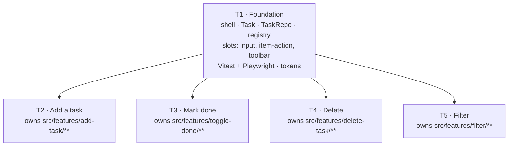

# New Factory for Claude Code

**Two skills · `/new-ba` and `/new-factory`** · design approved 26 Nov 2026 · `new-ba` built, `new-factory` in build

## Every batch runs on parallel tracks.

The old factory ran one issue at a time and split each issue into specs that waited on each other: a todo app took about five hours, and almost none of that was fixing bugs. The new pipeline moves the split to the start. The BA lays out a whole batch of tickets so that most of them can be built at once. The factory then runs every ticket on its own track, with one implementer, gates that are code rather than agents, and one QC at the end of the batch.

```
request ──▶ /new-ba ──▶ epic #10 (plan + tickets) ──▶ /new-factory #10 ──▶ staging ──▶ you ──▶ main
```

**Legend** · *script*: decided by code, never by an agent · *agent*: a fresh Claude session that judges · *you*: the only person in the loop, at the two ends

---

## One request is one batch, and one batch is one run.

| Step | Command | What it does |
|---|---|---|
| 1 | `/new-ba` | Turns a request into an epic and its tickets, designed to run in parallel, and publishes them to GitHub. |
| 2 | *you, on GitHub* | Read the batch; comment if something must change (`/new-ba` revises it). |
| 3 | `/new-factory #10` | Builds every ticket of epic #10, merges each into `staging`, runs one QC, reports. |
| 4 | *you* | Check `staging` and decide when it goes to `main`. |

The factory never touches `main`. There is no approval step in between: you look at the result, not at every step.

---

## The BA lays out the tracks before any train leaves.

The old BA divided work by layer, "data model before the screens", which made a chain where every ticket waited for the last. The new BA divides by behavior and pulls everything shared into one foundation ticket, so the tickets after it do not touch each other.

### Five words the BA thinks in

- **Slice** · one thing a user can do from start to end (add a task, filter the list). Never a layer.
- **Owns** · the only files a ticket may change. A folder is `dir/**`; its tests live inside it.
- **Foundation** · wave 0. The shared parts two or more slices would otherwise each change: types, interfaces, slots, registry, test setup, design tokens. No feature logic.
- **Contract** · a shape the foundation provides and slices build on (`TaskRepo`, `slot:input`). Only ever added to after wave 0, never changed.
- **Wave** · 0 is the foundation; slices that need nothing but the foundation are wave 1; a slice that needs another slice's behavior is wave 2. At most three.

### How a todo app is cut



T2 to T5 run at the same time. Each fills its own slot and registers itself, so none of them edits a shared file.

### The steps

1. **Understand the request.** Ask what changes the tickets, a few questions at a time. Keep the user's words in `said.md`, one line each. Choose the design direction now, from their references or from 2–3 truly different directions.
2. **Read or choose the architecture.** Find the hot files and the extension points; in a new repository, one folder per feature and a registry that loads them.
3. **List the slices.** One per user-visible behavior, at most about eight criteria each.
4. **Give each slice its Owns.**
5. **Pull out the foundation.** Default: one ticket. Past about eight criteria, feature logic has crept in.
6. **Order the waves.** Two slices that still share a file merge into one ticket; they are never queued.
7. **Write the tickets.**
8. **Prototype the whole flow,** with an independent design reviewer for at most two rounds.
9. **Check the batch** with `check-batch.mjs`.
10. **One fresh reader for the whole batch.**
11. **Publish** the epic and tickets.
12. **Revise after feedback,** keeping every published criterion number.

### What a ticket looks like

| Field | Example |
|---|---|
| Title | Add a task |
| Objective | People add a task by typing it. |
| Acceptance criteria | **C5** Given the list page, when the person types "Mua sữa" and presses Enter, then "Mua sữa" appears at the bottom of the list and the field is empty. **C6** … **C7** … |
| Out of scope | Editing a task after it is added. |
| Wave | 1 |
| Size | S · one field in an existing slot, three criteria, no new screen |
| Owns | `src/features/add-task/**` · `e2e/add-task.spec.ts` |
| Uses | `TaskRepo` from #11: `add(title)` · `slot:input` from #11 |
| Depends on | #11 |
| New dependencies | none |

Criteria are numbered across the whole batch (the foundation has C1–C4, the next ticket starts at C5), so an id means one thing everywhere.

### How each criterion is written

- **Checkable from outside.** Someone holding only the ticket and the product says met or not met.
- **Every behavior that must hold,** including the cases that go wrong.
- **One wording per rule.** Said once, in its criterion.
- **Behavior, not implementation,** except a contract, which is exact.
- **Their words are not narrowed.** "All", "every", "never" and numbers stay as said.
- **No open questions, no secrets, no real people's data.**

### The foundation also lays the rails for running in parallel

- The dev server and e2e read `PORT` and `BASE_URL`; e2e always starts its own server.
- E2e runs on the Playwright CLI with a JSON reporter.
- CSS is scoped per feature.
- Each feature declares its own routes, storage keys and shortcuts; the registry fails a test on any duplicate.
- Its tests assert only what later tickets will not change.

### Size: how much ceremony a ticket gets

| | When |
|---|---|
| **S** | Copy, config, a small bug: at most 3 criteria, no new screen, no auth, money or migration. |
| **M** | A normal feature. The default. |
| **L** | A complex new screen, or anything touching auth, money, migrations or security, however small. |

Size is the higher of size and risk. The factory checks it again by script and only ever raises it.

### `check-batch` refuses

- two tickets that can run at the same time and own the same file;
- a dependency that is not on an earlier wave, or a cycle;
- a criterion id in two tickets, or two tickets saying the same rule;
- a contract used but not defined, or not from a ticket it depends on;
- more than three waves without a reason;
- a size below what the factory would give it;
- two tickets declaring one library at different versions;
- a foundation with e2e but no `PORT` criterion;
- an Owns with no room for its tests;
- a plan that does not fit `plan-schema.json`.

### One reader for the whole batch

A fresh agent, never a fork, answers three questions. Can each ticket be built without guessing? Can two tickets that run together be built without knowing about each other? Does the foundation hold every contract? At most two rounds.

### Published, then read on GitHub

`publish-batch.mjs` scans for secrets, creates the epic and its tickets as sub-issues, pushes the prototype branch, and writes the plan with its hash into the epic. Every ticket gets the `ready` label. The tickets are the source of truth; the plan in the epic is a summary built from them.

---

## Follow one ticket down the line.

| # | Stop | Who | What happens |
|---|---|---|---|
| 0 | **Queue** | script | One batch at a time on `staging`. A second batch waits and starts from the newest `staging`. |
| 1 | **Plan** | script | Refuses without `ready`. Rebuilds the plan from the tickets with `check-batch` (seconds, no tokens). Edits since the BA are reported, not blocked. |
| 2 | **Prepare** | script | Once per batch: adds every declared library, copies the prototype, installs once, clones `node_modules` copy-on-write into each worktree, starts two servers on two ports and checks for a browser. |
| 3 | **Schedule** | script | A ticket starts as soon as what it depends on has merged. At most about four at once, each in its own worktree, port and cache. |
| 4a | **Build** | agent | One implementer, no planner, no spec. Codes, then one test per criterion, named with its id (`C5`). Changes only what the ticket owns. |
| 4b | **Gates** | script | The project's checks; the diff against Owns (from the commits, against this ticket's own base); every criterion has a test with a real assertion. |
| 4c | **Review** | agent | By size: S none, M one reviewer, L one on Opus plus a security review. The reviewer reads the tests too. |
| 4d | **Back to Build** | script + agent | Two fix rounds, then a diagnosis, then a third round or `needs-decision`. See below. |
| 5 | **Merge** | script | Straight into `staging`, `--no-ff`. Lockfiles regenerated. Checked once when a dependent ticket is waiting on it. |
| 6 | **QC** | script + agent | Once, when every ticket is done: a full check on the final `staging`, e2e reported per criterion, and one agent using the app in a browser. |
| 7 | **Report** | script | What was delivered, what waits on you and why, what changed since the BA. |
| 8 | **You** | you | Check `staging`; send it to `main` when you are satisfied. |

---

## Code owns the skeleton. Agents own the judgment.

The old factory ran inside a Workflow script, which cannot read or write a file, run a command or tell the time, so every deterministic step had to be an agent: a checker that ran tests, a recorder that wrote the dashboard. The new orchestrator is a plain Node program with no dependencies. It keeps its state in `state.json` and calls `claude -p` only when judgment is needed.

### The script decides

- the order tickets start, from the dependency graph;
- which files each ticket may change, and whether it did;
- whether the checks passed, from their exit codes;
- whether every criterion has a test;
- every merge, revert, label and comment;
- who a failure belongs to;
- when an agent is stuck, and why;
- the time, the cost and the dashboard.

### Agents judge

- **Implementer** · writes the code and its tests.
- **Reviewer** · is the change right against its criteria, and do its tests really test them.
- **Diagnoser** · after two failed rounds, why is it still failing.
- **Second reviewer** · settles a dispute with the first.
- **QC** · does the product do what the criteria say, used the way a person would.

### Lock table: when a ticket needs a file it does not own

| | Situation | What the script does |
|---|---|---|
| 1 | The file is free | Locks it, widens the ticket's Owns, runs the next round. |
| 2 | Held by a ticket that depends on this one | Hands the lock over: the holder only starts after this ticket merges. |
| 3 | Held by a ticket in `needs-decision` | This ticket waits too, as "waiting on #X", and is reported as not delivered. |
| 4 | Held by a ticket still running | Waits for it to merge, then runs from the new `staging`. |
| 5 | Waiting would close a circle | `needs-decision` at once, never an endless wait. |
| 6 | It is a contract file | Additions only; nothing already there may change. |

---

## Every failure is routed to the ticket that caused it.

| Failure | Found by | Sent to |
|---|---|---|
| A check fails in the worktree | script, 4b | that ticket |
| A file outside Owns was changed | script, 4b | that ticket, through the lock table |
| A criterion has no test, or an empty one | script, 4b | that ticket |
| A blocking review finding | reviewer, 4c | that ticket |
| Tests pass alone but fail once merged | script, 5 | the ticket whose merge broke them, found by splitting the merges in halves and re-running only the failing tests |
| The final `staging` does not typecheck or build | script, 6 | the same split |
| QC sees a criterion fail | QC, 6 | the ticket that owns the criterion; QC re-checks only what failed |
| A command never exits | watchdog | the stuck child process is killed by its PID; the agent carries on, and you get an alarm |

### When two rounds are not enough

| Diagnosis | What happens |
|---|---|
| **Hard code** | A third round on a stronger model (S → Sonnet, M → Opus, L → Opus at the highest effort), with the diagnosis. |
| **The ticket lacks room** | The lock table above. |
| **The judge was wrong** | The checks run again; a second, independent reviewer decides. |
| **The rules contradict** | `needs-decision` at once: code cannot settle what you asked for. |

A ticket gets at most four fix rounds over the whole batch, counting those sent back after merge or by QC. After that, and after a failed third round, it goes to **`needs-decision`**, never to "failed":

- its branch is kept;
- its issue gets the diagnosis and one concrete question, with the label `needs-decision`;
- if it was already merged, it is reverted from `staging`, with the tickets that depend on it, so `staging` holds only work that passed QC;
- the rest of the batch carries on;
- once you answer, the factory resumes that ticket alone (reverting the revert when it had been merged), then its dependents, then QC on their criteria.

### No timeouts. An alarm with a reason.

An agent with no progress for 30 minutes raises an alarm. Nothing is killed except a child process whose cause is recognised.

| Cause | Sign | Done on its own |
|---|---|---|
| A command never exits | dev server in the foreground, tests in watch mode, a y/n prompt | kills that child process by PID |
| API errors | 429 or 5xx, retrying | waits and retries |
| A loop | the same command or failing test, again and again | alarm only |
| A locked port or file | `EADDRINUSE`, a lock file | alarm only |
| Unknown | none of the above | alarm only |

The alarm says the ticket, the stop, the agent, how long, the cause, what was done, and the last 20 lines of the log. It goes out as a macOS notification and a comment on the ticket's issue.

---

## One ticket, one implementer, one session.

| Role | Model | Sees | May change |
|---|---|---|---|
| Implementer | S Haiku · M Sonnet · L Opus | its ticket, the contracts it uses, the prototype part it builds | the files it owns, its tests, commits in its worktree |
| Reviewer | M Sonnet · L Opus, plus security | the ticket, the diff, the tests | nothing |
| Diagnoser | — | the failures of both rounds, the diff, the ticket | nothing |
| Second reviewer | — | the ticket, the diff, the disputed finding | nothing |
| QC | — | the criteria, how to start the app | nothing |

No agent merges, pushes, labels or comments; the orchestrator does all of it. Each agent's brief is under about 4 KB. The diagnoser's, second reviewer's and QC's models are chosen when the factory is built.

### Gates a ticket passes, from its last commit to `main`

| # | Gate | Who | S | M | L |
|---|---|---|---|---|---|
| 1 | Project checks: lint, format, typecheck, build, unit, e2e | script | ✓ | ✓ | ✓ |
| 2 | Changes only what it owns | script | ✓ | ✓ | ✓ |
| 3 | A test with a real assertion for every criterion | script | ✓ | ✓ | ✓ |
| 4 | Review of the code and its tests | agent | — | ✓ | ✓ + security |
| 5 | Check after merging, when a ticket depends on it | script | (✓) | (✓) | (✓) |
| 6 | Full check on the final `staging` | script | ✓ | ✓ | ✓ |
| 7 | QC: e2e per criterion, plus a browser smoke | script + agent | ✓ | ✓ | ✓ |
| 8 | You | you | ✓ | ✓ | ✓ |

At most two agents judge a ticket: its reviewer and QC. The old factory had four or five for every criterion.

---

## Why it should be faster than the old line.

| | Old factory | New pipeline |
|---|---|---|
| Unit of a run | one issue | one batch of tickets |
| Split | the planner, into specs by layer, run in sequence | the BA, into slices by behavior, run in parallel |
| Who runs the checks | a checker agent | the orchestrator |
| Who writes the dashboard | a recorder agent at every step | the orchestrator |
| Judges per criterion | 4–5 | 1–2 |
| QC | per issue, clicking through MCP | once per batch, e2e first |
| Test-first proof | required, with its own runs | dropped; a test per criterion is checked by script |
| A stuck run | could hang for hours | alarm with a cause; known causes cleared on their own |
| A failure after many rounds | the run fails | `needs-decision`: one question, the rest carries on |

**Targets per ticket**, not yet measured: S 5–10 min · M 15–20 min · L about 30 min. For the todo app, a foundation plus four parallel slices plus one QC.

---

## Every run so far, as the dashboard recorded it.

| Date | Batch | Tickets · waves | Agents | Returns | Wall clock | Result |
|---|---|---|---|---|---|---|
| — | *no runs yet: the first is the todo app on the sandbox repository* | | | | | |

*Returns* counts fix rounds over the batch. *Agents* counts every `claude -p` session the orchestrator started. The orchestrator fills this table from `state.json`; nothing is written by hand.

For comparison, the old factory on the same todo app: four issues run one after another, about 42 minutes each to build, about five hours end to end.
